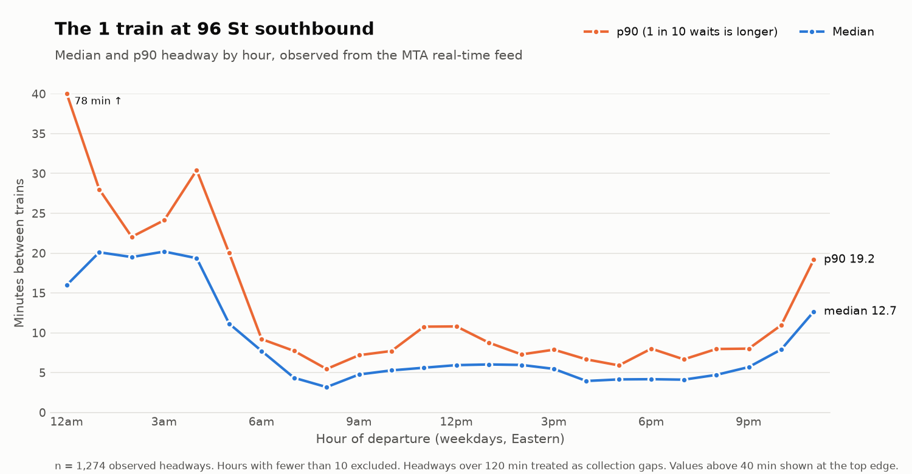
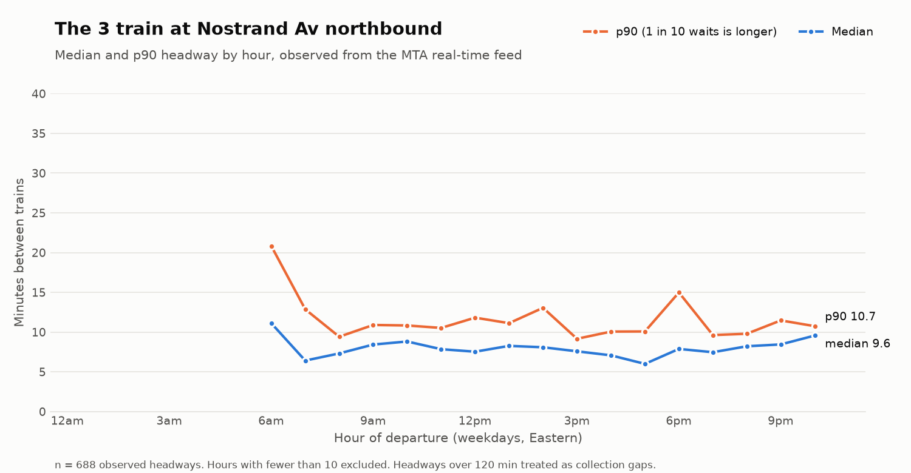
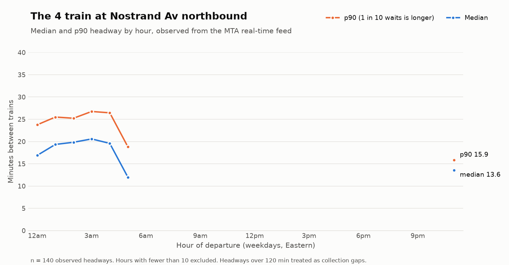
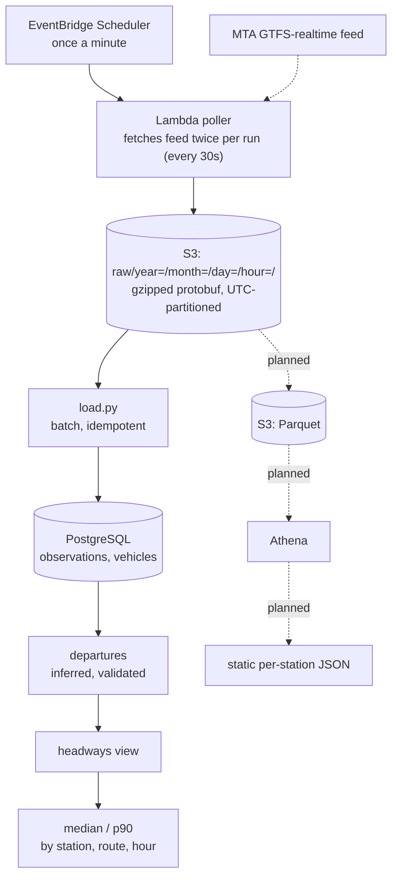

# MTA Subway Headways

How long do riders actually wait between trains? The MTA publishes a real-time
feed of predicted arrivals, but it never says when a train actually departs a
station. This project collects that feed continuously, infers departures from
how predictions change over time, validates the inference against the data,
and computes observed headways (the gap between consecutive trains) by
station, route, and hour.

Scope so far: the A Division (numbered lines: 1–7, plus the 42 St Shuttle).

**First result:** the 1 train southbound at 96 St, weekday mornings 8–10am,
from 162 observed departures: **median headway 3.7 min, p90 6.5 min.**



*The midnight p90 (78 min, shown at the top edge) comes from two ~111-minute
overnight gaps, both ending around 12:52am on separate nights, consistent with
planned overnight work.*

### The data recovers service patterns the feed never states

At Nostrand Av, the 3 runs from about 6am to 10pm and the 4 covers the same
stop overnight. That's the MTA's late-night service swap in Brooklyn,
recovered from observed departures alone, with no schedule data. Lines break
at hours with no service rather than drawing through them.

| 3 train | 4 train |
|---|---|
|  |  |

---

## Architecture



| Layer | Status |
|---|---|
| Ingest: Lambda + EventBridge → S3 | Running continuously (local poller from 2026-09-14, Lambda since 2026-09-15) |
| Load: S3 → PostgreSQL | Built; run manually per S3 prefix |
| Departures and headways | Built and validated on full days of data |
| Parquet in S3 + Athena query layer | Designed, not built (see below) |
| Static per-station JSON for a frontend | Designed, not built |

**Data window (as of 2026-10-10):**
- **Raw archive:** 74,157 snapshots (~2.4 GB gzipped) since 2026-09-14. That
  matches the ~74,100 expected from a 30-second schedule, so collection has
  run essentially without gaps for nearly four weeks.
- **Loaded and analyzed:** 2026-09-14 to 2026-09-22 in PostgreSQL, producing
  605,319 inferred departures. Loading is manual for now; the rest of the
  archive is pending.

**Scale:** ~2,880 snapshots/day, ~12M stop-level observations/day.
Gzip cuts each payload ~4.5x (≈86 MB/day to S3).

**Cost:** $0.41 total so far ($0.27 for September, $0.14 for October to
date), with Lambda inside the AWS free tier. At list prices, without the
free tier, it would be roughly $3.50/month, mostly Lambda duration (the
30-second sleep between fetches is billed time). The project works to a
self-imposed $5/month cap, which drove several design decisions below.

---

## The core problem: the feed never says a train left

Each snapshot lists, for every active trip, its remaining stops with
predicted times. When a train departs a station, that stop drops off the
front of its list. So the obvious rule is: *a stop disappearing = a departure.*

**That rule is wrong, and the data shows it.** Trip `063100_2..N02R` sat in
the feed for 27 minutes (55 consecutive polls) with all 48 of its stops
listed, then vanished. It was a scheduled train that never ran. The naive
rule would have recorded 48 departures for a train that did not exist, and
roughly 100 of ~260 trips in a typical poll look like this.

Worse, the error hides the thing being measured: cancellations would be
counted as service, so headways would look best exactly when service was
worst.

**What the pipeline does instead.** A departure is recorded only when:

1. the trip is **assigned** to a real train at that poll (the MTA's NYCT
   `is_assigned` extension, evaluated per row, because 83% of trips change
   assignment status during the day),
2. the stop is gone from the trip's **final** observed list (assignments can
   be revoked and departed stops can reappear),
3. the last prediction was within **±120s** of when the stop disappeared,
4. a departure or arrival time exists.

Vehicle position entities serve as independent corroboration.

**Accuracy.** Over a full day (76,696 candidates), the gap between the final
prediction and the observed disappearance has a median of +12s and a 5th–95th
percentile range of −51s to +55s. Inferred departure times are within about a
minute for 90% of departures, well inside the resolution needed for headways
measured in minutes. The ±120s filter removes 3% of candidates, and those are
either frozen predictions on delayed trains or trips withdrawn before running.

---

## Selected design decisions

Every decision, with the alternatives rejected and the reason, is in
[`docs/decisions.md`](docs/decisions.md). A few that shaped the design:

- **Poll every 30s, archive raw payloads forever.** Sampling can be reduced
  later but never increased, and a missed poll is unrecoverable. Raw
  protobuf is kept so any parsing bug can be fixed by reprocessing rather
  than re-collecting.
- **Partition by UTC, present in Eastern.** Eastern-time partitions break on
  daylight saving: one hour a year doubles up and one goes missing.
- **Idempotent loading.** Unique constraints plus `ON CONFLICT DO NOTHING`,
  one transaction per S3 object, and a `source_key` on every row. Verified
  by reloading the same hour twice: zero rows inserted on the second run.
- **No retries on the poller.** A retried fetch returns a *different*
  snapshot, so it recovers nothing and hides the real failure rate. Failures
  go straight to CloudWatch.
- **Least privilege.** The poller can only `PutObject` to one prefix; the
  loader can only read. Started with a scoped static key, then moved to a
  Lambda execution role and deleted the key.
- **Headways partition by (stop, route).** `stop_id` is station + direction,
  not platform. 96 St southbound carries the 1, 2, and 3, and mixing them
  produced impossible 2-second gaps.
- **No RDS.** The instance cost alone (~$12–15/month) breaks the budget, so
  the planned next layer is Parquet in S3 queried with Athena, with a nightly
  job writing small per-station JSON files. In production I'd use a managed
  database; the decision log prices that out.

---

## Known limitations

These are tracked in the decision log rather than hidden:

- **Origin terminals report schedule, not observation.** A train waiting at
  its starting station keeps its scheduled prediction until it leaves, so
  departures there land exactly on :00 or :30 seconds: 100% of the time at
  14 stop/route pairs, against a 3.3% chance baseline. Van Cortlandt Park
  (101S/1), South Ferry (142N/1), and both 42 St Shuttle ends are among them,
  along with Nereid Av (204S/5), a part-time short-turn terminal. The
  terminals are detected empirically from that signature, not from a
  hardcoded list. Their headways describe the timetable and should be
  excluded or labelled.
- **Collection gaps** produce one false headway at each boundary. Currently
  handled with a 120-minute cutoff, chosen from the distribution; the
  correct fix is to flag gaps from observation timestamps.
- **Shared vs. separate platforms.** At most express stations local and
  express share a platform, so a combined headway is right; at a few
  (e.g., 34 St–Penn on the 1/2/3) it is not. Neither the realtime nor the
  static feed encodes this, so it needs a hand-built mapping.
- **A trip's final stop never records a departure.** The train doesn't leave
  its last stop; the whole trip disappears from the feed instead. Where many
  trips end mid-line, counts drop sharply: Crown Hts–Utica Av southbound
  shows 93 departures for the 4, because most 4 trains terminate there.
- **An undocumented `E` trip designator** appears on ~99 trips/day across
  every route. Investigated, unresolved, treated as normal service.

---

## Repository layout

```
lambda/poll_handler.py   production poller (Lambda)
poll.py                  original local poller, superseded by the Lambda
load.py                  S3 → PostgreSQL batch loader
schema/                  table, index, and view definitions, in run order
queries/                 departure inference and analysis queries
scripts/plot_headways.py headway chart for any platform and route
scripts/                 one-off exploration used to validate assumptions
proto/                   GTFS-realtime + MTA NYCT extension definitions
data/gtfs-static/        static GTFS reference data (stations, routes)
docs/decisions.md        decision log
docs/img/                generated charts
```

## Running it

The raw archive lives in a private S3 bucket, so reproducing this end to end
means deploying your own poller and bucket. `load.py` currently reads three
hardcoded settings at the top of the file: `BUCKET`, `DSN` (`dbname=mta_rt`),
and the AWS profile name (`loader`, which needs `s3:GetObject` and
`s3:ListBucket` on the bucket).

```bash
pip install -r requirements.txt

# create the database and tables, in order
createdb mta_rt
for f in schema/*.sql; do psql mta_rt -f "$f"; done

# load station names from static GTFS
psql mta_rt -c "\copy stops FROM 'data/gtfs-static/stops.txt' CSV HEADER"

# load an hour or a day from S3 (safe to re-run)
python load.py raw/year=2026/month=09/day=15/

# derive departures (safe to re-run)
psql mta_rt -f queries/insert_departures.sql
```

The poller deploys as a single file (`lambda/poll_handler.py`, no
dependencies beyond the Lambda runtime) with a `BUCKET` environment variable,
a 60s timeout, async retries set to 0, and a once-a-minute EventBridge
Scheduler rule.

### Charting other stations

`scripts/plot_headways.py` reads the `headways` view and writes a PNG for any
platform and route. Stop IDs are the station number plus direction (`N`/`S`);
`--list` shows which ones a route serves.

```bash
python scripts/plot_headways.py --list 6                    # stop IDs on the 6
python scripts/plot_headways.py --stop 127N --route 2       # 2 at Times Sq-42 St, northbound
python scripts/plot_headways.py --stop 631S --route 6       # 6 at Grand Central, southbound
python scripts/plot_headways.py --stop 635N --route 4 --days weekend
python scripts/plot_headways.py --stop 128S --route 1       # 34 St-Penn, a split-platform station
python scripts/plot_headways.py --stop 248N --route 3       # 3 at Nostrand Av, northbound
python scripts/plot_headways.py --stop 248N --route 4       # 4 at Nostrand Av, northbound
```

Charts for each of these are in [`docs/img/`](docs/img/).

Weekdays are the default because weekday and weekend timetables differ;
mixing them blurs the rush-hour pattern. `--days weekend` works, but the
loaded window has only two weekend days, so overnight hours mostly fall
below the 10-headway minimum and drop out.

## Next

1. Parquet + Athena layer, with the loader as a container-image Lambda
2. Scheduled loading instead of manual
3. Terminal and collection-gap flags
4. Static per-station JSON and a small frontend

---

## How this was built

I used AI assistance (Claude) throughout, for drafting code, SQL, and
documentation and for talking through design options. The design decisions
and the validation are mine: every assumption about the feed was checked
against collected data before anything was built on it, and every number in
this README comes from a query I ran. The decision log records what was
checked and how, including the places where an initial assumption, mine or
the AI's, turned out to be wrong.

**Related work:** [subway.fyi](https://subway.fyi) maintains a more
comprehensive historical archive of the same feeds. I found it about three
weeks into this project. Its methodology independently arrives at the same
foundation (raw feed bytes archived as the source of truth), but none of its
code or data is used here. This is a from-scratch build, and the decision log
is the main artifact.
